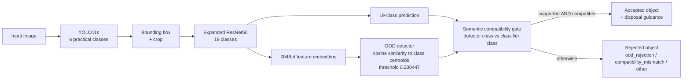
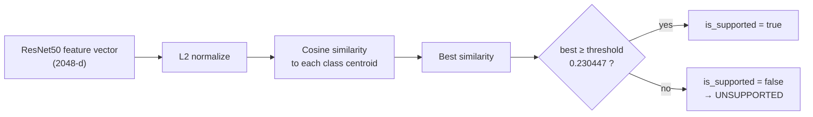
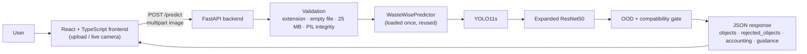

<div align="center">

# WasteWise AI

### Intelligent Multi-Class Waste Detection and Classification Using Neural Networks

*A guarded, multi-stage computer-vision pipeline that detects waste, classifies it into 19 categories, rejects unsupported or inconsistent predictions, and only then returns disposal guidance.*


**Open Ended Project (OEP) · Artificial Intelligence · Computer Engineering · Academic Year 2026–27**
Sarvajanik College of Engineering & Technology (SCET), Sarvajanik University, Surat, Gujarat, India

</div>

---

## Table of Contents

1. [Overview](#1-overview)
2. [Problem Statement and Motivation](#2-problem-statement-and-motivation)
3. [Objectives](#3-objectives)
4. [Key Idea](#4-key-idea)
5. [System Architecture](#5-system-architecture)
6. [End-to-End Workflow](#6-end-to-end-workflow)
7. [Detector (YOLO11s)](#7-detector-yolo11s)
8. [Classifier (Expanded ResNet50)](#8-classifier-expanded-resnet50)
9. [OOD Detection](#9-ood-detection)
10. [Semantic Compatibility Gate](#10-semantic-compatibility-gate)
11. [Disposal Guidance](#11-disposal-guidance)
12. [Datasets and Taxonomy](#12-datasets-and-taxonomy)
13. [Training and Preprocessing](#13-training-and-preprocessing)
14. [Evaluation Results](#14-evaluation-results)
15. [Medical Waste 4.0 Evaluation](#15-medical-waste-40-evaluation)
16. [Application Architecture](#16-application-architecture)
17. [Backend API](#17-backend-api)
18. [Frontend](#18-frontend)
19. [Repository Structure](#19-repository-structure)
20. [Model Artifacts](#20-model-artifacts)
21. [Installation](#21-installation)
22. [Running the Backend](#22-running-the-backend)
23. [Running the Frontend](#23-running-the-frontend)
24. [API Usage Examples](#24-api-usage-examples)
25. [Reproducibility](#25-reproducibility)
26. [Limitations](#26-limitations)
27. [Future Work](#27-future-work)
28. [Technology Stack](#28-technology-stack)
29. [Academic Information](#29-academic-information)
30. [Team](#30-team)
31. [Disclaimer](#31-disclaimer)
32. [License](#32-license)
33. [Repository Link](#33-repository-link)

---

## 1. Overview

WasteWise AI takes a photograph and produces, for every waste object it accepts, a localized bounding box, a detailed waste class, a confidence value, and a disposal recommendation. It is built as a **chain of independent checks** rather than a single classifier:

| Stage | Component | Role |
|:--|:--|:--|
| 1 | **YOLO11s** | Localizes candidate objects using 6 broad, practical classes |
| 2 | **Object crop** | Cuts each detected box out of the image |
| 3 | **Expanded ResNet50** | Classifies each crop into 19 detailed classes |
| 4 | **Embedding-based OOD detector** | Rejects crops that are not close enough to any known class |
| 5 | **Semantic compatibility gate** | Rejects crops whose detailed class is inconsistent with the detector's coarse class |
| 6 | **Disposal guidance** | Looks up a category and recommendation for accepted objects only |

Every raw detection is accounted for in the output, so the pipeline is auditable end to end.

> **Honest summary of current performance.** The classifier is strong on the evaluated splits (see [§14](#14-evaluation-results)). The detector is comparatively weak and is **the main bottleneck** of the end-to-end system (see [§7](#7-detector-yolo11s)). This project makes no claim of state-of-the-art or production-grade end-to-end accuracy.

---

## 2. Problem Statement and Motivation

Recognizing waste is not the same as predicting a label. A standard image classifier always answers, even when the input is:

- an **unsupported** object that belongs to none of its classes,
- a **confident but wrong** prediction,
- **semantically inconsistent** with what an upstream detector saw, or
- **outside the feature space** the model was trained on.

For waste segregation, a forced and wrong label can send an item to the wrong stream. WasteWise AI therefore treats recognition as a *guarded decision problem*: a prediction becomes an accepted result only after independent checks agree.

---

## 3. Objectives

| # | Objective | Realized by |
|:-:|:--|:--|
| 1 | **Detect** waste objects in an image | YOLO11s (6 practical classes) |
| 2 | **Classify** each object in detail | Expanded ResNet50 (19 classes) |
| 3 | **Reject** unsupported or inconsistent predictions | OOD detector + semantic compatibility gate |
| 4 | **Guide** the user on disposal | Rule-based category and recommendation per class |
| 5 | **Serve** the pipeline | FastAPI backend and React/TypeScript frontend |

---

## 4. Key Idea

```text
Naive pipeline :  IMAGE ─────────────────────────────────────────────▶ LABEL

WasteWise AI   :  IMAGE ─▶ DETECT ─▶ CLASSIFY ─▶ OOD CHECK ─▶ COMPATIBILITY CHECK ─▶ ACCEPT / REJECT ─▶ GUIDANCE
```

**Two independent checks must agree before a prediction is accepted.** This improves auditability and filters inconsistent predictions; it does not by itself make the whole system highly accurate, and the detector's limitations remain.

---

## 5. System Architecture



---

## 6. End-to-End Workflow

Implemented in [`src/inference/predict.py`](src/inference/predict.py) (`WasteWisePredictor`).

1. **Load** the image and correct EXIF orientation, then convert to RGB.
2. **Detect** with YOLO11s (`imgsz=640`, default confidence `0.35`).
3. **Clamp** each box to the image bounds and **crop** it. Boxes smaller than 2 px, or invalid, are counted as `other_rejected`.
4. **Classify** the crop with the Expanded ResNet50 (Resize 256 → CenterCrop 224 → ImageNet normalization). The top-3 predictions are returned.
5. **OOD check** on the crop's 2048-d embedding.
6. **Compatibility check** of the predicted class against the detector's class.
7. **Accept or reject.** Accepted objects receive a category and recommendation; rejected objects are returned separately with a `rejection_reason`.
8. **Account** for every raw detection:

```text
RAW DETECTIONS  =  ACCEPTED  +  OOD REJECTED  +  COMPATIBILITY REJECTED  +  OTHER REJECTED
```

The response includes `accounting.is_valid` to confirm the identity holds for each request.

> The crop is the detected bounding box clamped to the image. The code does not add padding or otherwise enlarge the box.

---

## 7. Detector (YOLO11s)

| Property | Value |
|:--|:--|
| Model | Ultralytics YOLO11s (fine-tuned from `yolo11s.pt`) |
| Taxonomy (6 broad classes) | `plastic`, `glass`, `metal`, `paper_cardboard`, `biological`, `other_trash` |
| Outputs | Bounding boxes, detector confidence, object localization |
| Default confidence threshold | `0.35` |
| Training data | TACO (practical 6-class) train split + external garbage-detection train split |
| Training script | [`scripts/train_taco_external_yolo11s_balanced.py`](scripts/train_taco_external_yolo11s_balanced.py): 90 epochs, `imgsz=640`, batch 16, patience 20, `cls_pw=0.5` |
| Production checkpoint | `runs/detect/results/taco_external_balanced/yolo11s_balanced/weights/best.pt` |

The detector vocabulary is deliberately **coarse and practical**; fine-grained identification is left to the classifier.

### Detector results (E4 validation)

> These are **detector metrics** (precision / recall / mAP), not classification accuracy.

| Images | Instances | Precision | Recall | mAP@0.50 | mAP@0.50:0.95 |
|:-:|:-:|:-:|:-:|:-:|:-:|
| 149 | 407 | 0.216 | 0.261 | 0.232 | 0.188 |

| Class | mAP@0.50 |
|:--|:-:|
| plastic | 0.443 |
| metal | 0.371 |
| paper / cardboard | 0.267 |
| other_trash | 0.065 |
| glass | 0.0158 |

### TACO practical baseline — separate evaluation setting

Shown for context only. It is a **different evaluation setting** and must not be read as a like-for-like comparison with the E4 validation above.

| Precision | Recall | mAP@0.50 | mAP@0.50:0.95 |
|:-:|:-:|:-:|:-:|
| 0.282 | 0.387 | 0.306 | 0.236 |

> **The detector is currently the main performance bottleneck of the end-to-end pipeline.** Localization quality, especially for `glass` and `other_trash`, limits what the downstream stages can do.

---

## 8. Classifier (Expanded ResNet50)

Defined in [`src/models/resnet50_model.py`](src/models/resnet50_model.py) (`WasteResNet50`).

- ImageNet-pretrained ResNet50 backbone.
- The original 1000-class layer is replaced by a small head: `Dropout(0.4) → Linear(2048, 256) → ReLU → Dropout(0.3) → Linear(256, 19)`.
- `extract_features()` returns the 2048-d embedding before the head; this is what the OOD detector uses.

**The 19 classes**

| | | | |
|:--|:--|:--|:--|
| `battery` | `biological` | `cable` | `cardboard` |
| `clothes` | `electronic_device` | `gauze` | `general_trash` |
| `glass` | `medical_cap` | `medical_glasses` | `medical_gloves` |
| `metal` | `paper` | `plastic` | `shoe_cover` |
| `shoes` | `test_tube` | `urine_bag` | |

Production checkpoint: `models/expanded_resnet50_stage2_best.pth`.

---

## 9. OOD Detection

Implemented in [`src/inference/ood_detector.py`](src/inference/ood_detector.py).



- Class centroids come from the **expanded validation set** and are stored in `models/expanded_ood_calibration.json`.
- The **calibrated threshold is `0.230447`**: the 1st percentile of correct-class cosine similarities on the expanded validation set ([`scripts/calibrate_expanded_ood.py`](scripts/calibrate_expanded_ood.py)).
- The OOD result contains `is_supported`, `best_class`, `similarity`, `threshold` and per-class `similarities`.
- The threshold can be overridden per request with the `ood_threshold` query parameter.

### Recorded rejection example

```text
classifier prediction : cardboard
        │
best OOD similarity   : 0.1996
        │
threshold             : 0.2304
        │
0.1996 < 0.2304  ──▶  UNSUPPORTED IMAGE (rejected)
```

> **Limitation.** OOD rejection is a partial safeguard, not a guarantee. A recorded negative-set run on 5,000 MS-COCO val2017 images rejected 42.24 % and accepted 57.76 % of them (see [§26](#26-limitations)).

---

## 10. Semantic Compatibility Gate

YOLO uses broad classes; ResNet uses detailed ones. An object is **accepted only if**:

1. the OOD detector says it is **supported**, **and**
2. the ResNet prediction belongs to the set of detailed classes **compatible** with the YOLO class.

Otherwise it is rejected. The production compatibility map (`DETECTOR_CLASS_COMPATIBILITY` in `predict.py`):

| YOLO detector class | Compatible ResNet classes |
|:--|:--|
| `plastic` | `plastic`, `cable`, `medical_cap`, `medical_gloves`, `shoe_cover`, `urine_bag` |
| `glass` | `glass`, `test_tube`, `medical_glasses` |
| `metal` | `metal`, `battery`, `electronic_device` |
| `paper_cardboard` | `paper`, `cardboard` |
| `biological` | `biological` |
| `other_trash` | `general_trash`, `clothes`, `shoes`, `gauze`, `medical_cap`, `medical_gloves`, `shoe_cover`, `plastic`, `paper`, `cardboard` |

Rejected objects carry one of these reasons: `ood_rejection`, `compatibility_mismatch`, or are counted under `other_rejected` (for example, an invalid bounding box).

---

## 11. Disposal Guidance

Guidance is a **rule-based lookup** keyed by the accepted classifier class (`DISPOSAL_GUIDANCE` in `predict.py`). Each class maps to a category and a generic recommendation sentence.

| Category | Classes |
|:--|:--|
| Recyclable | `cardboard`, `glass`, `metal`, `paper`, `plastic` |
| Hazardous / E-waste | `battery` |
| E-waste | `cable`, `electronic_device` |
| Medical Waste | `gauze`, `medical_cap`, `medical_glasses`, `medical_gloves`, `shoe_cover`, `test_tube`, `urine_bag` |
| Organic Waste | `biological` |
| Reusable / Textile | `clothes`, `shoes` |
| General Waste | `general_trash` |

Guidance is generic and does not encode local regulations (see [§31](#31-disclaimer)). Objects rejected by OOD are reported as `Unsupported Image` and receive no disposal recommendation.

---

## 12. Datasets and Taxonomy

> **Dataset policy.** Raw third-party datasets are **not** redistributed through this repository. They may carry their own licenses and redistribution restrictions; obtain them from their original sources and follow their terms. The repository contains the **code, configuration and audit outputs** used to process them.

### Datasets referenced by the project

| Dataset | Role in this project |
|:--|:--|
| Garbage dataset (10 core classes) | Classifier train / validation / test (core classes) |
| Medical Waste 4.0 (Dataset A) | Classifier train / validation (medical classes) |
| Medical Waste 4.0 (Dataset B) | Isolated external test split (see [§15](#15-medical-waste-40-evaluation)) |
| TrashNet++ | Selected classifier data; YOLO-format split used for detector/pipeline evaluation |
| TACO | Source of the practical 6-class detection splits |
| Garbage object-detection dataset | External detection data combined with TACO for the final detector |
| MS-COCO val2017 | Negative (non-waste) images for OOD analysis |

Per-dataset counts and roles are documented in [`docs/DATASET_COVERAGE_AUDIT.md`](docs/DATASET_COVERAGE_AUDIT.md).

### Taxonomy

[`configs/dataset_taxonomy.yaml`](configs/dataset_taxonomy.yaml) defines canonical classes and families and the project's data principles, including: never modify raw datasets, preserve source labels, keep TACO detection-oriented, keep COCO outside the waste classifier, and de-duplicate across datasets before training.

### Dataset audit and hygiene artifacts

Dedicated audit tooling was implemented for **integrity, provenance, taxonomy and duplicate checks**. Outputs are stored under [`results/dataset_audit/`](results/dataset_audit/):

| Artifact | Purpose |
|:--|:--|
| `canonical_manifest.csv`, `canonical_manifest_summary.json`, `canonical_manifest_validation.json` | Canonical manifest and its validation |
| `integrity_summary.json`, `garbage_dataset_integrity.json` | Dataset integrity |
| `coco_annotation_audit.json`, `taco_annotation_audit.json` | Annotation audits |
| `cross_dataset_taxonomy_audit.csv` / `.json` | Cross-dataset taxonomy audit |
| `trashnet_duplicate_provenance.json`, `trashnet_plus_plus_integrity.json` | TrashNet / TrashNet++ provenance and integrity |
| `medical_waste_4_0_integrity.json`, `medical_waste_4_0_structure_audit.json` | Medical Waste 4.0 integrity and structure |
| `cross_dataset_duplicates/` | Exact cross-split hashes and perceptual duplicate candidates |
| `robust_duplicate_audit/unique_image_manifest.csv` | Unique-image manifest |

The split builder ([`scripts/create_expanded_splits.py`](scripts/create_expanded_splits.py)) asserts that SHA-256 hashes are disjoint across train, validation and test. This is a safeguard, not a proof that every form of leakage (for example near-duplicates) has been eliminated.

---

## 13. Training and Preprocessing

### Classifier training (two stages)

| | Stage 1 | Stage 2 |
|:--|:--|:--|
| Script | [`train_expanded_resnet50_stage1.py`](scripts/train_expanded_resnet50_stage1.py) | [`train_expanded_resnet50_stage2.py`](scripts/train_expanded_resnet50_stage2.py) |
| Starting point | ImageNet-pretrained ResNet50 | Stage 1 checkpoint |
| Trainable layers | Classification head (backbone frozen) | `layer4` + head |
| Epochs | 25 | up to 20 (script setting) |
| Batch size | 32 | 32 |
| Learning rate | 0.0005 | backbone 0.00005, head 0.0005 |
| Weight decay | 0.0001 | 0.0001 |
| Scheduler | ReduceLROnPlateau | ReduceLROnPlateau (patience 3) |
| Best checkpoint | epoch 20 | epoch 6 |

### Inference preprocessing

```text
IMAGE → Resize(256) → CenterCrop(224 × 224) → ToTensor → Normalize → ResNet50
```

| | Values |
|:--|:--|
| ImageNet mean | `[0.485, 0.456, 0.406]` |
| ImageNet std | `[0.229, 0.224, 0.225]` |

---

## 14. Evaluation Results

> **Read the labels.** Validation Macro-F1, held-out test metrics, detector mAP and external accuracy are **different measurements**. Do not compare them directly.

### 14.1 Classifier — validation (model selection)

| Model | Best epoch | Validation Macro-F1 | Notes |
|:--|:-:|:-:|:--|
| Stage 1 | 20 of 25 | **95.75 %** | Accuracy 95.73 %, Macro Precision 95.06 %, Macro Recall 96.58 % |
| Stage 2 (19 classes) | 6 | **96.80 %** | Best-checkpoint validation Macro-F1 |

These are **validation Macro-F1** values. They are **not** test accuracy and **not** end-to-end accuracy.

### 14.2 Classifier — held-out test split (2,646 images, 19 classes)

Recorded in `results/metrics/expanded/expanded_resnet50_stage{1,2}_test_metrics.json`.

| Model | Accuracy | Macro Precision | Macro Recall | Macro-F1 | Weighted-F1 |
|:--|:-:|:-:|:-:|:-:|:-:|
| Stage 1 | 94.37 % | 93.65 % | 95.25 % | 94.38 % | 94.41 % |
| Stage 2 (production) | **95.73 %** | 95.85 % | 96.17 % | **95.99 %** | 95.74 % |

Per-class reports and confusion matrices are stored in `results/metrics/expanded/` and `results/figures/`. The weakest classes on the Stage 2 test split by F1 are `general_trash` (0.883), `metal` (0.887) and `plastic` (0.905).

> Stage 1's best *validation* accuracy (95.73 %) and Stage 2's *test* accuracy (95.73 %) happen to be numerically equal. They are separate measurements on different splits.

### 14.3 Detector

See [§7](#7-detector-yolo11s). Precision 0.216, recall 0.261, mAP@0.50 0.232, mAP@0.50:0.95 0.188 on E4 validation (149 images, 407 instances). **The detector is the bottleneck.**

### 14.4 Integrated pipeline — acceptance accounting

Recorded in `results/metrics/integrated_evaluation_all_datasets.json`. These are **acceptance / rejection counts with accounting verified (`accounting_valid = true` for all five)**. They are *not* accuracy figures, because no ground-truth correctness is measured here.

| Dataset (split) | Images | Raw detections | Accepted | OOD rejected | Compatibility rejected | Other | Accepted share of raw |
|:--|:-:|:-:|:-:|:-:|:-:|:-:|:-:|
| TACO practical (test) | 151 | 195 | 57 | 10 | 128 | 0 | 29.2 % |
| TrashNet++ YOLO (test) | 265 | 1,357 | 513 | 54 | 790 | 0 | 37.8 % |
| Medical Waste Dataset B | 801 | 1,173 | 531 | 11 | 631 | 0 | 45.3 % |
| Garbage external (test) | 1,042 | 2,482 | 1,146 | 274 | 1,062 | 0 | 46.2 % |
| Core garbage (test) | 1,977 | 4,340 | 2,195 | 283 | 1,862 | 0 | 50.6 % |

In every case most rejections are **compatibility rejections**, consistent with the detector's coarse class often disagreeing with the classifier.

### 14.5 Example production inference

| Input | Raw detections | Accepted | Recorded inference time |
|:--|:-:|:-:|:-:|
| `plastic_42.jpg` | 10 | 2 | 1194.64 ms |

> **This is one recorded example, not an average latency benchmark.** No average or throughput figure should be inferred from it.

---

## 15. Medical Waste 4.0 Evaluation

Medical Waste 4.0 has two parts in this project: **Dataset A** (5,520 images) was placed in the classifier's **training / validation pool**, and **Dataset B** (801 images) was **kept isolated** as the external test split (`policy` values `medical_train_validation` and `medical_external_test` in `canonical_manifest.csv`; `scripts/create_expanded_splits.py`). The two evaluations below must not be confused.

### 15.1 Full-dataset sweep, supported subset (Dataset A + B)

| Discovered | Supported | Excluded | Correct | Incorrect | Inference errors |
|:-:|:-:|:-:|:-:|:-:|:-:|
| 6,321 | 6,249 | 72 | 6,195 | 54 | 0 |

**The Expanded ResNet50 Stage 2 achieved 99.14 % classification accuracy on the supported subset of the Medical Waste 4.0 dataset (Datasets A and B combined).**

| Class | Correct / Total | Accuracy |
|:--|:-:|:-:|
| gauze | 600 / 630 | 95.24 % |
| medical_cap | 438 / 438 | 100 % |
| medical_glasses | 486 / 486 | 100 % |
| medical_gloves | 2,764 / 2,787 | 99.17 % |
| shoe_cover | 972 / 972 | 100 % |
| test_tube | 482 / 483 | 99.79 % |
| urine_bag | 453 / 453 | 100 % |

> **Interpretation limits.** This is **classification accuracy** on the **supported subset** only (the 72 unsupported `medical_filter` images are excluded). It is **not** overall dataset accuracy, **not** end-to-end accuracy and **not** detection accuracy. Because Dataset A (5,520 supported images) was part of the classifier's training/validation pool, this figure is **not an independent held-out result**.

### 15.2 Independent split — Dataset B only (801 images)

Recorded in `results/metrics/expanded/medicalB/expanded_resnet50_stage2_medicalB_metrics.json`.

| Images | Supported | Excluded (`medical_filter`) | Accuracy (supported) | Macro-F1 (supported) |
|:-:|:-:|:-:|:-:|:-:|
| 801 | 729 | 72 | **95.20 %** | **95.43 %** |

| Class | Precision | Recall | F1 | Support |
|:--|:-:|:-:|:-:|:-:|
| gauze | 1.000 | 0.688 | 0.815 | 93 |
| medical_cap | 0.891 | 1.000 | 0.942 | 57 |
| medical_glasses | 1.000 | 1.000 | 1.000 | 93 |
| medical_gloves | 0.915 | 0.980 | 0.946 | 252 |
| shoe_cover | 0.971 | 1.000 | 0.985 | 135 |
| test_tube | 1.000 | 0.981 | 0.991 | 54 |
| urine_bag | 1.000 | 1.000 | 1.000 | 45 |

The independent split shows a real weakness on `gauze` recall (68.8 %), which the pooled 99.14 % figure hides. Treat **95.20 %** as the more conservative estimate of external generalization on this dataset.

### Source-label mapping (simplified)

```text
SOURCE LABELS  →  AUDIT / TAXONOMY MAPPING  →  SUPPORTED WASTEWISE CLASSES   |   UNSUPPORTED

gauze, gauzes                      → gauze
glove_pair_* / glove_single_*      → medical_gloves
medical_cap                        → medical_cap
medical_glasses                    → medical_glasses
shoe_cover_pair / shoe_cover_single→ shoe_cover
test_tube                          → test_tube
urine_bag                          → urine_bag
medical_filter                     →  UNSUPPORTED (excluded)
```

---

## 16. Application Architecture



The model pipeline is initialized once at server start-up (with lazy initialization as a fallback) and reused across requests.

---

## 17. Backend API

[`backend/main.py`](backend/main.py) · title **WasteWise AI API** · version **1.0.0** · CORS enabled for all origins.

### Endpoints

| Method | Path | Purpose |
|:--|:--|:--|
| `GET` | `/` | Service name, status, version and pipeline description |
| `GET` | `/health` | Liveness, device, detector/classifier names, OOD threshold |
| `GET` | `/ready` | Readiness; `503` if the pipeline is not fully loaded |
| `POST` | `/predict` | Run the full pipeline on an uploaded image |

### `POST /predict`

- Body: `multipart/form-data`, field `file`.
- Optional query parameters: `confidence_threshold` (0–1, default `0.35`), `ood_threshold` (0–1, default `0.230447`).
- Accepted extensions: `.jpg`, `.jpeg`, `.png`, `.webp`.

**Validation performed**

| Check | Failure response |
|:--|:--|
| Missing filename / unsupported extension | `400` |
| Empty file (0 bytes) | `400` |
| File larger than 25 MB | `413` |
| Corrupt or invalid image (PIL verify + load) | `400` |
| Inference failure | `500` |

**Response structure** (abridged; values below are placeholders showing the schema, not real output)

```json
{
  "success": true,
  "version": "1.0.0",
  "filename": "image.jpg",
  "duration_ms": 0.0,
  "image": { "width": 0, "height": 0, "filename": "image.jpg" },
  "detector": {
    "model": "…/yolo11s_balanced/weights/best.pt",
    "confidence_threshold": 0.35,
    "classes": ["plastic", "glass", "metal", "paper_cardboard", "biological", "other_trash"],
    "raw_detections": 0,
    "accepted_detections": 0
  },
  "classifier": { "class_count": 19, "ood_threshold": 0.2304 },
  "objects": [
    {
      "object_id": 0,
      "bounding_box": { "x1": 0, "y1": 0, "x2": 0, "y2": 0, "width": 0, "height": 0 },
      "detector": { "class": "…", "confidence": 0.0 },
      "classifier": {
        "is_supported": true,
        "prediction": "…",
        "confidence": 0.0,
        "confidence_level": "high | moderate | low",
        "category": "…",
        "recommendation": "…",
        "ood_similarity": 0.0,
        "ood_threshold": 0.2304,
        "ood_best_class": "…",
        "top_predictions": [ { "class": "…", "confidence": 0.0 } ]
      },
      "accepted": true,
      "rejection_reason": null
    }
  ],
  "rejected_objects": [ { "…": "same shape; accepted=false; rejection_reason = ood_rejection | compatibility_mismatch | …" } ],
  "summary": { "raw_detections": 0, "accepted_objects": 0, "ood_rejections": 0, "compatibility_rejections": 0, "other_rejections": 0, "accounting_valid": true },
  "accounting": { "raw_detections": 0, "accepted_detections": 0, "ood_rejected": 0, "compatibility_rejected": 0, "other_rejected": 0, "total_rejected": 0, "is_valid": true },
  "confidence_threshold": 0.35,
  "ood_threshold": 0.230447
}
```

> Note: the two top-level `confidence_threshold` / `ood_threshold` fields echo the request override, or the defaults `0.35` / `0.230447` when no override is given. The effective values used by each stage are also in `detector` and `classifier`.

Further detail is in [`docs/API_CONTRACT.md`](docs/API_CONTRACT.md); where it differs from the structure above, the structure above follows the running code (see [§25](#25-reproducibility)).

---

## 18. Frontend

Located in [`frontend/`](frontend/).

- **Image upload** workflow (`UploadZone`, `WasteAnalyzer`) showing detections, categories, confidences and disposal guidance.
- **Live camera** workflow (`LiveCamera`) that samples frames in the browser and sends them to `/predict` on a 500 ms interval.
- A typed API client in [`frontend/src/services/api.ts`](frontend/src/services/api.ts) mirroring the backend response.
- The API base URL is currently hard-coded to `http://127.0.0.1:8000` in `api.ts`.
- Presentation layer: React 19, TypeScript, Vite 8, Tailwind CSS 4 (via `@tailwindcss/vite`), GSAP and Lenis for animation and smooth scrolling, Lucide icons. `motion` and `recharts` are also declared as dependencies.

---

## 19. Repository Structure

Structure as inspected. Items marked *(local)* are expected by the code but are not tracked in plain Git (see [§20](#20-model-artifacts)).

```text
WasteWise-AI/
├── backend/
│   └── main.py                    # FastAPI application
├── configs/
│   └── dataset_taxonomy.yaml      # canonical classes, families, data principles
├── docs/
│   ├── API_CONTRACT.md
│   ├── AI_READINESS_REPORT.md     # see note in §25 before relying on its numbers
│   ├── DATASET_COVERAGE_AUDIT.md
│   ├── FRONTEND_INTEGRATION.md
│   └── RELEASE_CHECKLIST.md
├── frontend/
│   ├── package.json
│   ├── vite.config.ts
│   └── src/
│       ├── App.tsx, main.tsx, index.css
│       ├── components/            # WasteAnalyzer, UploadZone, LiveCamera, ...
│       └── services/api.ts
├── results/
│   ├── dataset_audit/             # manifests, integrity, taxonomy, duplicate audits
│   ├── metrics/                   # classifier / OOD / external / integrated metrics
│   ├── reports/                   # classification reports (legacy 10-class)
│   ├── figures/                   # confusion matrices, distributions
│   └── inference/                 # sample inference outputs
├── scripts/
│   ├── (audit_*, build_*, create_*, calibrate_*, train_*, evaluate_* ...)
│   └── evaluation/                # evaluation entry points
├── src/
│   ├── data/                      # datasets, dataloaders, transforms
│   ├── models/                    # resnet50_model.py (+ legacy cnn_baseline.py)
│   ├── training/                  # training code (+ legacy baseline)
│   ├── evaluation/                # evaluation code
│   └── inference/
│       ├── predict.py             # PRODUCTION pipeline (WasteWisePredictor)
│       ├── ood_detector.py        # OOD detector
│       └── predict_backup.py, predict_before_e4.py   # superseded versions
├── audit_*.py                     # root-level audit helpers
├── requirements.txt
├── models/   (local)              # classifier checkpoint + OOD calibration
├── runs/     (local)              # YOLO detector run + weights
└── data/     (local)              # third-party datasets and splits (not redistributed)
```

---

## 20. Model Artifacts

| Artifact | Path | Role |
|:--|:--|:--|
| Classifier | `models/expanded_resnet50_stage2_best.pth` | **Production** Expanded ResNet50 (Stage 2) |
| OOD calibration | `models/expanded_ood_calibration.json` | **Production** class centroids and threshold (0.230447) |
| Detector | `runs/detect/results/taco_external_balanced/yolo11s_balanced/weights/best.pt` | **Production** YOLO11s |

These paths are the defaults in `WasteWisePredictor`. Large model files are tracked with **Git LFS**, so after cloning:

```bash
git lfs install
git lfs pull
```

Earlier experimental checkpoints (for example the Stage 1 checkpoint and the legacy 10-class models) are **not** production models.

---

## 21. Installation

### Requirements

- Python 3.10+ (the release checklist records Python 3.12)
- A CUDA-capable GPU is recommended but not required; the pipeline falls back to CPU
- Node.js and npm for the frontend (the release checklist records Node v20+)
- Git and Git LFS

### Backend

```bash
git clone https://github.com/Drashtant007/WasteWise-AI.git
cd WasteWise-AI
git lfs install && git lfs pull

python -m venv .venv
# Windows:  .venv\Scripts\activate        macOS/Linux:  source .venv/bin/activate

pip install -r requirements.txt
pip install ultralytics fastapi "uvicorn[standard]" python-multipart
```

> `requirements.txt` pins the data-science and PyTorch stack (the pinned PyTorch build is a CUDA 13.0 build, `+cu130`). It **does not list** `ultralytics`, `fastapi`, `uvicorn` or `python-multipart`, which the backend imports, so they are installed in the second command. Adjust the PyTorch line to match your platform if needed.

### Frontend

```bash
cd frontend
npm install
```

---

## 22. Running the Backend

From the repository root:

```bash
python -m uvicorn backend.main:app --host 127.0.0.1 --port 8000
```

Check that the models loaded:

```bash
curl http://127.0.0.1:8000/ready
```

For development with auto-reload, `python -m backend.main` starts the same app on `127.0.0.1:8000` with `reload=True`. If a model file is missing, start-up logs a warning and `/ready` returns `503`.

---

## 23. Running the Frontend

```bash
cd frontend
npm run dev          # development server (Vite)
npm run build        # type-check (tsc -b) and production build
npm run preview      # preview the production build
npm run lint         # ESLint
```

Open the URL printed by Vite. The frontend expects the backend at `http://127.0.0.1:8000`.

---

## 24. API Usage Examples

**curl**

```bash
curl -X POST "http://127.0.0.1:8000/predict" \
     -F "file=@sample.jpg"

# With overrides
curl -X POST "http://127.0.0.1:8000/predict?confidence_threshold=0.35&ood_threshold=0.230447" \
     -F "file=@sample.jpg"
```

**Python**

```python
import requests

with open("sample.jpg", "rb") as f:
    r = requests.post("http://127.0.0.1:8000/predict", files={"file": f})
r.raise_for_status()
result = r.json()

print(result["accounting"])                 # raw = accepted + rejected, by reason
for obj in result["objects"]:
    c = obj["classifier"]
    print(obj["detector"]["class"], "->", c["prediction"], c["category"])
for obj in result["rejected_objects"]:
    print("rejected:", obj["rejection_reason"])
```

**Command-line inference (no server)**

```bash
python -m src.inference.predict path/to/image.jpg
```

---

## 25. Reproducibility

### Scripts

Run from the repository root. Datasets must first be obtained and placed under `data/` (not distributed here).

| Task | Script |
|:--|:--|
| Build and validate canonical manifest | `scripts/build_canonical_manifest.py`, `scripts/validate_canonical_manifest.py` |
| Create expanded splits | `scripts/create_expanded_splits.py` |
| Train classifier | `scripts/train_expanded_resnet50_stage1.py`, then `scripts/train_expanded_resnet50_stage2.py` |
| Calibrate OOD threshold | `scripts/calibrate_expanded_ood.py` |
| Train detector | `scripts/train_taco_external_yolo11s_balanced.py` |
| Evaluate classifier / external sets | `scripts/evaluate_expanded_resnet50_stage2.py`, `scripts/evaluate_medical_b_external_stage2.py`, `scripts/evaluation/evaluate_medical_waste.py` |
| Dataset audits | `scripts/audit_*.py`, `scripts/dataset_integrity_audit.py`, `scripts/robust_cross_dataset_duplicate_audit.py`, `scripts/medical_waste_audit.py` |

Example:

```bash
python scripts/evaluate_expanded_resnet50_stage2.py
```

### Where each reported number comes from

| Result | Source in this repository |
|:--|:--|
| Stage 1 validation (95.75 %, epoch 20) | `results/metrics/expanded/expanded_resnet50_stage1_history.json` |
| Stage 2 validation Macro-F1 (96.80 %, epoch 6) | Project report / checkpoint metadata (an expanded Stage 2 training-history file is not in `results/`) |
| Held-out test metrics (Stage 1, Stage 2) | `results/metrics/expanded/*_test_metrics.json` |
| Dataset B independent evaluation | `results/metrics/expanded/medicalB/` |
| Integrated acceptance accounting | `results/metrics/integrated_evaluation_all_datasets.json` |
| Detector E4 validation and TACO baseline | Project report (raw detector validation output is not stored in `results/`) |
| Full-dataset 99.14 % sweep (6,321 images) | Project report; evaluation script `scripts/evaluation/evaluate_medical_waste.py`; counts consistent with the audit files |
| `plastic_42.jpg` example (10 → 2, 1194.64 ms) | Project report (single recorded example) |

### Documentation caveats

- [`docs/AI_READINESS_REPORT.md`](docs/AI_READINESS_REPORT.md) contains detector and latency figures (for example mAP@50 of 0.461, a confidence sweep, and 35–55 ms latency) and an OOD description (95th percentile) that **do not match** the verified metrics and the calibration script in this README. Its numbers are not used here.
- [`docs/API_CONTRACT.md`](docs/API_CONTRACT.md) shows an older response layout (`box_index`, `bbox` arrays). The running backend returns the structure in [§17](#17-backend-api).
- [`docs/FRONTEND_INTEGRATION.md`](docs/FRONTEND_INTEGRATION.md) and [`docs/RELEASE_CHECKLIST.md`](docs/RELEASE_CHECKLIST.md) mention React 18 / Vite 6; `frontend/package.json` specifies React 19 and Vite 8.

---

## 26. Limitations

- **The detector is the main bottleneck.** E4 validation: precision 0.216, recall 0.261, mAP@0.50 0.232. `glass` (0.0158) and `other_trash` (0.065) are especially weak.
- **Many detections are rejected by the compatibility gate** on the recorded integrated runs (see [§14.4](#144-integrated-pipeline--acceptance-accounting)). The gate protects against inconsistent labels but also discards detections.
- **OOD is a partial safeguard.** A recorded run on 5,000 MS-COCO val2017 images (`results/metrics/expanded/coco_ood/expanded_resnet50_stage2_coco_ood_metrics.json`) recorded an OOD rejection rate of 42.24 % and a false-acceptance rate of 57.76 %. That run used a threshold of 0.2383, not the production 0.230447, so it is indicative rather than a measurement of the production setting.
- **The 99.14 % Medical Waste 4.0 figure is not independent** because Dataset A was in the training/validation pool; the isolated Dataset B result is 95.20 % with weak `gauze` recall (68.8 %).
- **Validation vs. test vs. external.** Validation Macro-F1 (95.75 %, 96.80 %) is used for model selection and is not a test or end-to-end accuracy.
- **Dataset scope.** Evaluation covers the datasets listed in [§12](#12-datasets-and-taxonomy). More real-world imagery and deployment validation are needed.
- **No latency benchmark.** The 1194.64 ms value is a single example; no average or throughput benchmark is claimed.
- **Frontend configuration.** The API URL is hard-coded to localhost.
- **Open CORS.** The backend allows all origins, which is convenient for development but should be restricted for any public deployment.

---

## 27. Future Work

- A stronger detector and improved small-object detection
- Broader real-world data and deployment validation
- More robust end-to-end evaluation with ground-truth correctness on the accepted objects
- Re-calibrating and re-evaluating OOD at the production threshold on non-waste negatives
- Configurable API base URL and tighter CORS for deployment
- Edge deployment

---

## 28. Technology Stack

| Layer | Technologies |
|:--|:--|
| **Detection** | Ultralytics YOLO11s |
| **Classification** | PyTorch, torchvision, ResNet50 (ImageNet-pretrained) |
| **OOD** | ResNet feature embeddings, class centroids, cosine similarity |
| **Data / evaluation** | NumPy, pandas, scikit-learn, SciPy, matplotlib, seaborn, OpenCV, Pillow, PyYAML, TensorBoard |
| **Backend** | FastAPI, Uvicorn, Pillow |
| **Frontend** | React 19, TypeScript, Vite 8, Tailwind CSS 4, GSAP, Lenis, Lucide React, motion, Recharts |
| **Tooling** | ESLint, Git LFS |

---

## 29. Academic Information

| | |
|:--|:--|
| **Project** | WasteWise AI: Intelligent Multi-Class Waste Detection and Classification Using Neural Networks |
| **Type** | Open Ended Project (OEP), Artificial Intelligence |
| **Department** | Computer Engineering |
| **Institution** | Sarvajanik College of Engineering & Technology (SCET), Sarvajanik University |
| **Location** | Surat, Gujarat, India |
| **Academic year** | 2026–27 |

---

## 30. Team

| Name |
|:--|
| Drashtant Mevada |
| Smit Rathod |
| Nirav Panwala |
| Krish Tandel |
| Ronak Solanki |

---

## 31. Disclaimer

WasteWise AI is an **academic research prototype**. It is not a certified waste-management, medical-waste or regulatory-compliance system. Its predictions can be wrong, and its disposal guidance is generic. Medical and hazardous waste must always be handled according to local regulations and qualified professionals, not according to this software. Third-party datasets remain subject to their original licenses.

---

## 32. License

No license file was present in the inspected snapshot of this repository. Until one is added, all rights are reserved by the authors. Add a `LICENSE` file to state reuse terms, and note that third-party datasets and pretrained weights (including Ultralytics and ImageNet weights) carry their own licenses.

---

## 33. Repository Link

**https://github.com/Drashtant007/WasteWise-AI**
